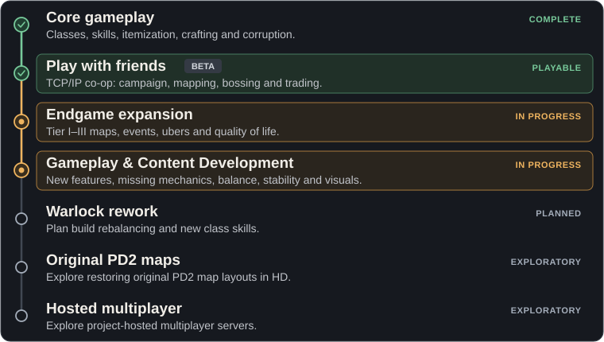

# Project Diablo II: Resurrected

Project Diablo II rebuilt as a Diablo II: Resurrected mod.

[Discord](https://discord.com/invite/KWGqVxmpDR) | [Launcher](https://github.com/synpoox/resurrected-launcher)

**Status: alpha 0.2.7** · Single-player and TCP/IP co-op (beta) playable

[Install](#install) · [Roadmap](#roadmap) · [Upcoming content](#upcoming-content) · [Changelog](CHANGELOG.md) · [Known differences](docs/deviations.md)

**Alpha notice:** Back up characters before updating; save compatibility is not guaranteed. TCP/IP co-op is in beta; bugs and incomplete functionality may remain.

## Requirements

- Windows and Diablo II: Resurrected 3.4.0 or 3.3.0 with Reign of the Warlock. One
  release runs on both: D2RLoader runs its own 3.3 engine image with the installed game's data.
- [D2RLoader](https://d2rloader.net/) 1.3.1-beta.

Classic and Lord of Destruction characters use the mod's inventory layout with their native class and act rules.
Choose Reign of the Warlock at character creation for the PD2 gameplay port.

## Install

### Launcher
1. Download and install the latest launcher: https://github.com/synpoox/resurrected-launcher
2. Go to `Settings` and select your D2R directory.
3. Click `Install` from the main screen. 

Manual installation and updates

1. Unpack `PD2Resurrected-<version>.7z` into `<D2R folder>\mods\`, so that
   `mods\PD2Resurrected\PD2Resurrected.mpq\modinfo.json` exists.
2. Make `PD2Resurrected` D2RLoader's default mod (once): in D2RLoader's settings, or with
   `default_mod = "PD2Resurrected"` in `<D2R folder>\d2rloader\config\d2rloader.toml`.
3. Start `D2RLoader.exe`. Characters are saved in `Saved Games\Diablo II Resurrected\mods\PD2Resurrected\`.

To update, delete `mods\PD2Resurrected\PD2Resurrected.mpq\data` first, also delete `mods\PD2Resurrected\d2rloader\plugins\core-maps.dll` if it is there (the old name of `core-events.dll`; both loaded together would hook the game twice), then unpack the new release the same way.

### Linux

Runs under Wine/Proton with the manual install: [docs/linux.md](docs/linux.md).

## Roadmap

What's playable right now?

- All seven original PD2 classes and the adapted Warlock.
- PD2 items, runewords, crafting and corruption.
- Tier I–III maps, map events and invaders.
- Uber Tristram, Diablo Clone, Rathma and Mendeln, and Lucion with Desecration (testing and polish remain).
- 10×8 inventory, charm rows, 4×4 Cube and dedicated stash tabs.
- Seven loot filters and controller improvements.
- TCP/IP co-op (beta).

## Upcoming content

Ongoing polish and known differences

- Stability, save safety, skill and item accuracy, HD effects, animations, replacement artwork and controller usability remain ongoing priorities.
- PD2R currently uses D2R-native maps and arenas; restoring original PD2 map layouts in HD is exploratory. Terror Zones replace corrupted zones; D2R's Uber Ancients remain. Dedicated PvP content is not in scope.
- Original PD2 maps, hosted multiplayer, three new Warlock skills, guilds and cosmetics are not guaranteed commitments.

No fixed release dates have been announced. Features can progress in parallel and plans may change as testing progresses.

[Technical roadmap](docs/roadmap.md) · [Detailed differences from PD2](docs/deviations.md)

## Loot Filters

The mod ships [Pyre Loot Filter](https://github.com/Pyre-Flies/D2R-Mods/blob/main/plugins/pyre-lootfilter/README.md) with seven profiles, from Starter (default) to Endgame.

- Switch profiles or disable filtering in **Esc > Loot Filter**. Changes apply immediately and persist across updates.
- Create or edit a filter in the [PD2R loot filter builder](https://synpoox.github.io/pd2r-lootfilter/). Chrome and Edge can save directly to the game folder.
- Save custom filters under a new name in `<D2R folder>\mods\PD2Resurrected\d2rloader\config\filter\`. Set `selected_filter` in `pyre-lootfilter.toml` to use your custom filter.
- Updates replace shipped `pd2r-*.json` files, not custom filters. Native D2R `.fltr` filters are unavailable while Pyre is installed.

## Controller Support

The included Controller QOL Updates plugin (PyreFly) adds the following controls:

- **RT / RB:** change main menu page / skill tab (reversed from D2R). Use `qol menu on/off` in the console to toggle.
- **LB + X / A / Y:** pick up labeled ground items. Potions go to the belt.
- **Right stick:** aim cursor with nearby enemy snapping.

[Full controller controls and status](docs/controller.md)

## Cut features

These PD2 features are left out on purpose. Every deviation from PD2, cut or not, is listed in
[docs/deviations.md](docs/deviations.md).

- PD2's stash pages: D2R's stash stays for now.
- PvP: the PvP maps, the BR Arena and every PvP rule, including the arenas' life regen cap.
- Corrupted zones: D2R's Terror Zones stand in.
- PD2's Uber Ancients: D2R's own Uber Ancients stays.
- Chat commands: `.kills`, `.deaths`, `.played`, `.age`, `.allstats`, `.accountstats` and `.noexp`.

## Bug reports

Found a bug? [Open an issue](https://github.com/synpoox/pd2-resurrected/issues/new) and say:

- what happened, and what you expected;
- how to make it happen again (class, level, difficulty, area, skill or item);
- the mod version (in the release's file name, e.g. `0.1.0-alpha`).

First check the [deviation list](docs/deviations.md): what is on it is known and not a bug yet.

## Contributing

Want to help? See [CONTRIBUTING.md](CONTRIBUTING.md).

## License

MIT for our own work: see [LICENSE](LICENSE). It does not cover Blizzard's game data, Project Diablo 2's content or the bundled companion plugins; see [NOTICE.md](NOTICE.md).
