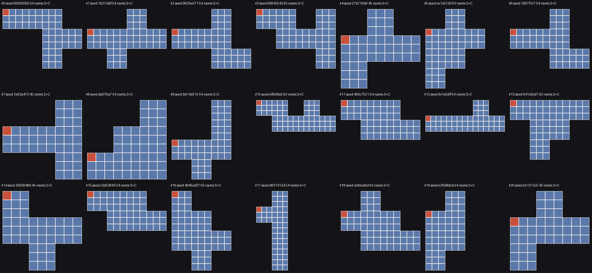
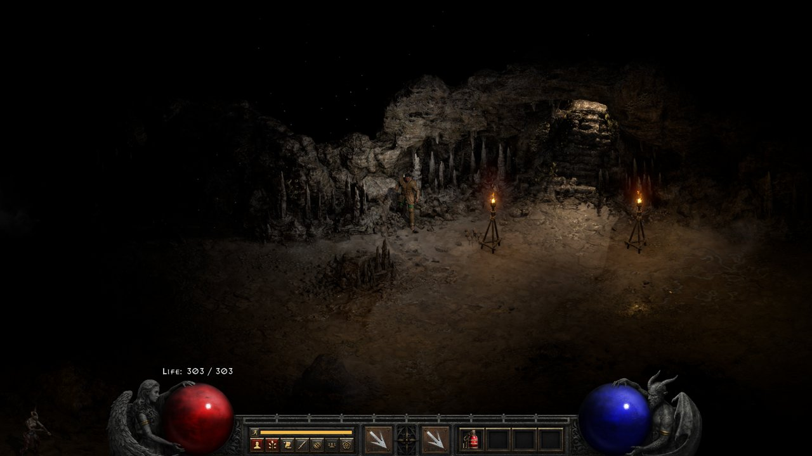
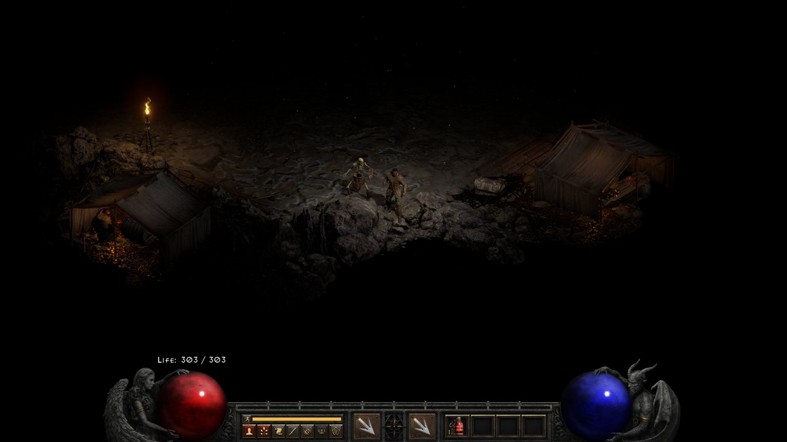
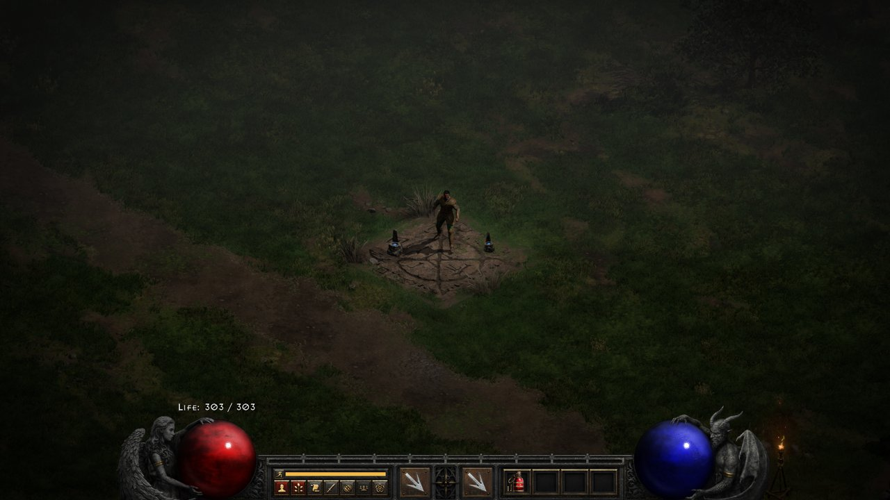
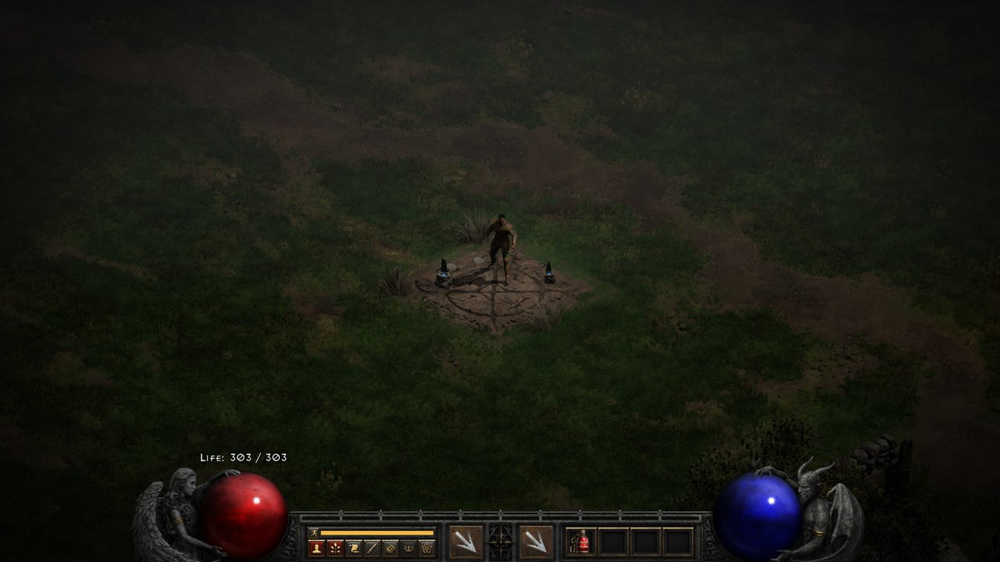
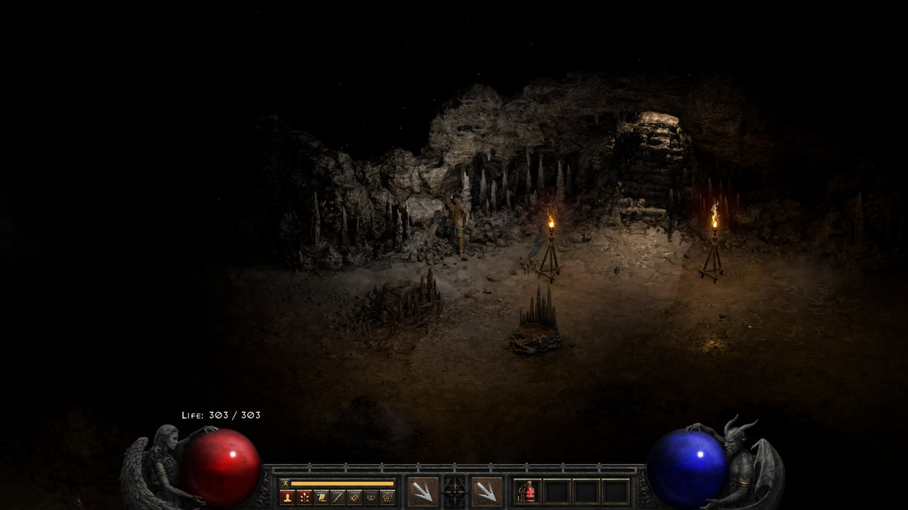

# Level regeneration in a running game (Cartographer phase 1)

Issue #927. Phase 1 of the Cartographer plan (`docs/plans/cartographer-plugin.md` on `docs/map-kit-plan`): can a
level be erased and rebuilt with a new seed, many times in one game, without crashes? Every address below is from
our own D2R 93847 Ghidra project (`D2R.gpr`, image stamp `0x6ab3782c`), queried with the toolkit's
`tools/ghidra_query.ps1`. No code or address was taken from locbones/D2RHUD-2.4; only its approach was the starting
point.

## Verdict

**Works, with caveats.** Cave Level 1 (level 9, a maze level) was rebuilt 20 times in one Hell game, each
time with a new layout and fresh monsters, entered between rebuilds by cheat warp; leaving the game and starting a
new one did not crash, and an outdoor level (Cold Plains) rebuilt too. The first attempt crashed on round 2, which found the main caveat (the saved room bits,
below); the fix is in the prototype. The caveats:

1. **Three pieces of per-level state must be reset**, beyond the rooms: the saved room bits (`level +0x258`), the
   inactive-unit store entries of the level's rooms (`game +0x1b0`), and the drlg seed for that level. Missing the
   first one corrupts the heap (it crashed); missing the second restores old monsters, objects and items into the new
   layout.
2. **"Empty" has to settle first.** The native removability test refuses for a few seconds after the last player
   leaves (room status decays to 4, and the linked level's bordering rooms must decay too). Cartographer must refuse
   (or queue) the open until then.
3. **Remote clients are not done.** The local client in single player rebuilds the same layout, because its act has
   the same seed and the hook serves both. A remote client needs `{level, seed}` sent to it (phase 9).
4. **Superunique "spawned" bits were not found** in the time box (D2RHUD's `game +0x5670` is not a field in 93847).
   Cave Level 1 has Coldcrow; see "Superuniques".
5. **Outdoor levels keep their act-placed frame.** Cold Plains (level 3) rebuilt with new paths and ground
   around the same waypoint spot: the rectangle, the borders and the fixed presets are chosen by the act at alloc,
   not by the build. It was also refused for as long as the player stood in the Rogue Encampment next to it, with
   every room of both copies decayed; it passed from Lut Gholein. A slot level should not border a town.
6. **Seed overrides outlive the game.** In single player the act seed comes from the character, so a new game has
   the same act seed and the prototype's override (keyed by act seed and level) still applied. Cartographer must
   drop its overrides when the act is freed (D2RHUD does this in its act-free hook).

## How D2R builds and frees levels (D2Common `Drlg\Drlg.cpp`)

| RVA | What it is |
|---|---|
| `0x2ef1c0` | **Act alloc** `(dataFlag, actNo, seed, isClient, owner, difficulty, townLevel, cb, cb) -> act` (0x90 bytes). Act `+0x14` seed, `+0x70` drlg. The server calls it from `0x48aa50` (`D2Game\src\Game\Level.cpp`) with the game seed `game +0x12c`; the client calls it from `0x86bc0`. |
| `0x2ef130` | **Act free** `(dataFlag, act)`: frees the drlg (`0x326600`), the act's rooms and the act. |
| `0x326ba0` | **Drlg alloc**: seeds the drlg's RNG from the act seed and keeps `+0x840` = act seed, `+0x858` = act, **`+0x860` = the level seed base** (the RNG's first value), **`+0x868` = the level list**, `+0x870` = act number. |
| `0x326600` | **Drlg free**: for each level in `+0x868` (next `+0x1b8`): level free `(.., 0)`, then pool free (`0x1230490` on pool `0x2a9a810`); then the drlg itself. This is the act teardown that frees every level record. |
| `0x3267c0` | **AllocateLevel / get-or-make** `(dataFlag, drlg, levelId) -> level`: walks `+0x868`; if absent, allocates a record from pool `0x2a9a810`, sets `+0x1c8` drlg, `+0x1f8` id, `+0x0` drlg type (levels.txt `+0x30`: 1 maze, 2 preset, 3 outdoor), seeds `+0x1e4` from `drlg +0x860 + levelId`, runs the type's alloc-time init (maze `0x3e7760`: `+0x18` = LvlMaze record; preset `0x3dd6a0`; outdoor `0x3ee6e0`) and links it at the head of `+0x868`. |
| `0x3271c0` | **Level build** `(dataFlag, level)`: **re-seeds `+0x1e4` from `drlg +0x860 + levelId` on every build**, runs the type builder (maze `0x3e69e0`, preset `0x3dd3c0`, outdoor through thunk `0x3e2b5ce`), then re-applies the saved room bits from `+0x258` by room index, then finds the warp spots. Callers build only when `level +0x10` (first room) is null. |
| `0x327c40` | **Level free** `(dataFlag, level, keep)`: tells a registry (`0x362360() + 0x28`, `0x327a10`), then with `keep` 1 saves bit 0 of each room's `+0xa0` into an int array at `+0x258` (allocated only if null, sized by the room count at that time), frees each room (`0x360cf0`), frees the preset list at `+0x1c0` (`0x3ddbb0`), runs the type free (`keep` 0 also clears a maze's `+0x18`), and zeroes the room fields. **The level record stays.** |
| `0x327e70` | **Level removable** `(dataFlag, level) -> 1`: every room has status byte `+0x70 >= 4` and no `+0x50` bit `0x100000`, and so does every room of the up to 8 linked levels (`0x360800`) that borders this one; those border rooms are then unlinked (`0x360f50`). |
| `0x2efff0` -> `0x327370` | **DungeonRemovePastLevels**: for each built level of the act whose `+0xc` is 0, a timer at `+0x1fc` counts 10 passes, then if removable: level free `(.., keep 1)`. The server runs it every 11 frames for each act (`0x406550`); the client every 13 frames for its act (`0x94b40`). |
| `0x326480` | Room init: passes the room callback (thunk `0x3e2b5bc` -> `jmp [0x3e2ac28]`, D2Game's room creation) a mode: 0 for a fresh room, **1 when room `+0xa0` bit 0 is set** ("populated before": no new monsters or presets), 4 for rooms with `+0x50` bit `0x40000`. |

Level record fields used: `+0x0` drlg type, `+0x8` room count, `+0x10` first room (next `+0x48`), `+0x18` maze record,
`+0x24/+0x28/+0x2c/+0x30` rectangle in tiles, `+0x1b8` next level, `+0x1c0` preset list, `+0x1c8` drlg, `+0x1e4`
level RNG, `+0x1f8` id, `+0x1fc` unload timer, `+0x258` saved room bits. Room (`DrlgRoom`): `+0x48` next, `+0x50`
flags, `+0x60/+0x64/+0x68/+0x6c` tile x, y, w, h, `+0x70` status, `+0x90` level, `+0xa0` bit 0 populated.

### The seed field and the level list

D2RHUD used `drlg +0x860` (seed) and `+0x868` (level list) on 2.4. **Both are unchanged in 93847.** The level's
layout seed is `drlg +0x860 + levelId`, read by both `0x3267c0` (alloc) and `0x3271c0` (every build).

## The key finding: D2 already erases and rebuilds levels

`DungeonRemovePastLevels` frees the rooms of every level nobody is near, on the server and on the client, and the
next visit builds it again from the same seed. So "free a level and rebuild it in a running game" is native,
constant behaviour; the level record is never freed until the act is. A regeneration is that same native unload
plus three resets:

1. **A different seed for that one level.** A hook on `0x3271c0` (and `0x3267c0`, for a level made for the first
   time) writes the override's base into `drlg +0x860` for that call only and restores it after. The override is
   keyed by `(drlg +0x840, levelId)`: the act seed is the game seed on both sides, so the server's copy and the local
   client's copy build the same new layout. A nested build of another level of the same drlg inside the window (the
   preset builder `0x3dd3c0` makes linked levels) sees the true base again (a per-thread window stack). The hook
   must stay in place for the life of the map, because the native unload rebuilds the level whenever a player comes
   back; changing `+0x860` once would also re-roll every other level of the act on its next rebuild.
2. **Drop the saved room bits (`level +0x258`).** The native unload keeps "this room was populated" per room index
   so a rebuilt level does not respawn. After a new layout these bits are wrong, and worse: `0x327c40` reuses the
   array it allocated for the first layout and writes one int per room into it. **A new layout with more rooms
   (54 -> 63 here) writes past the array**, and the next free crashes (crash 1 below). Drop the array at regen and
   in the build hook whenever the level's layout seed changed since the bits were saved.
3. **Purge the inactive-unit store for the level** (`D2Game\src\Unit\SUnitInactive.cpp`). When a server room
   deactivates, D2Game saves its monsters, objects (chest and shrine states) and items in a per-act list at
   `game +0x1b0` (count `+0x1b8`), keyed by the room's subtile corner (tile x, y * 5), sorted by x descending.
   `0x503790` (objects, items) and `0x505d70` (monsters, respawned at their saved spot by `0x493670`) restore them
   when a room **with the same corner** activates. A new maze layout reuses the same 8x8 grid, so old monsters and
   ground items would come back inside the new layout, possibly in walls. Node (0x28 bytes): `+0 x`, `+4 y`, `+8`
   list (next `+0`), `+0x10` monsters (next `+0xd0`; `+0x20` list freed by `0x4a5240`, `+0x28` block by `0x3dbaf0`),
   `+0x18` units (next `+0x30`), `+0x20` next node. `0x504ee0` finds or makes a node; `0x503e10` frees them all at
   game end, and the prototype frees one node the same way. Purge every node inside the level's rectangle
   (`level +0x24..+0x30`, tiles): after a native unload the room list is gone, so the rooms alone cannot name them.
   The game check purged 1-5 stale entries per round. **This is also where "ground items and corpses are discarded"
   happens**: they are units of inactive rooms.

### Tombstones are not needed (for a slot that keeps its drlg type)

D2RHUD freed the level record and kept it as an unlinked tombstone until the act was freed. In 93847 the record does
not need to be freed at all: the native unload keeps it, every pointer to it (rooms' `+0x90`, the act's list, the
level-link tables, which hold ids) stays valid, and the act teardown `0x326600` frees it as usual. Nothing dangles,
and no teardown hook is needed.

A tombstone becomes necessary only if a slot level must change its **drlg type or LvlMaze/LvlPrest record between
opens** (phase 2), because the type's alloc-time init runs only in `0x3267c0`. Then: unlink the record from
`drlg +0x868` (fix the previous record's `+0x1b8`), keep it in a plugin list, call `0x3267c0` for a fresh record, and
hook `0x326600`'s entry to link the tombstones back into `+0x868` so its own loop frees them. Before that, check the
registry `0x327a10` notifies (`0x362360() + 0x28`) for holders of the old pointer.

## Population

- **Monsters and presets.** Each new room is created with mode 0 (`0x326480`), so D2Game populates it as a fresh
  room: preset units and random monster groups from the level's levels.txt row. The bit that stops repopulation is
  room `+0xa0` bit 0; regeneration clears it by dropping `+0x258`. Nothing else has to be "run again": room
  activation repopulates.
- **Superuniques.** Not found in the time box. D2RHUD's per-game bits at `game +0x5670` do not exist in 93847 (no
  instruction uses that displacement on a game). The superunique table getter is `0x4983c0` (rows at data tables
  `+0x1448`, `0x20` bytes) and `D2Game\src\Monster\MonsterUnique.cpp` holds the spawners (`0x49ead0` minions,
  `0x49f230`, `0x49c620`). The getter's callers (`0x49c620`, `0x49e470`, `0x49ead0`, `0x498e10`, `0x49ef90`,
  `0x49a650`, `0x49a7e0`, `0x4996b0`, `0x49f230`) were read; none tests a per-game bit array, so the "already
  spawned" check lives elsewhere (likely in the preset-monster spawn path of the room callback). Next step for
  phase 3: break on a superunique's spawn in a debugger, or diff the game struct before and after killing one. Until
  then a regenerated level's superunique may or may not respawn; slot levels can simply have none.
- **Quests, waypoints, portals.** Not looked at. A slot level should have no quest, waypoint or fixed portal; the
  map's own portal is Cartographer's.

## The client

- The client has its own act and drlg (`0x86bc0`; the client's current act is the global `0x2a233b0`, its data flag
  the byte at `0x2a210a0 + 0x9cf`) and builds levels lazily with the same `0x3267c0` / `0x3271c0` when the server
  shows it rooms. It unloads them with the same native remover.
- In the game check every regenerated level was built twice per entry, once per drlg (server, then client), with the
  same seed and the same room list (`server+client same: True` in the log). So in single player and for a TCP/IP
  host, the client needs nothing but the shared hook and a free of its copy (or the native unload of it) before the
  player enters.
- **What a remote client needs:** the override `{act seed, level id, layout seed}` before it enters (the plugin is
  Shared, so its hook is there), its copy freed and its `+0x258` dropped (the build hook does this when the seed
  changed). If the client's copy is still built and in use when the seed changes, it shows the old walls: the server
  must wait for each client to confirm (plan step 7).

## Is the level empty?

Server: no player whose room's level (`0x34b440` unit -> room, `0x2efc10` room -> level id) is the slot, by walking
the game's clients (`game +0x138`, next `+0x628`, `0x484c90` client -> player), **and** `0x327e70` (no active or
held room, including the linked level's border rooms). Room flag `0x100000` holds a room (not identified which
units set it; corpses and portals are candidates). Client: `0x327e70` on the client's copy. Corpses and ground items
are not a reason to refuse: they are discarded with the level (inactive store purge).

The test is strict for a few seconds after the last player leaves: room status decays to 4 over time, and the
linked level's bordering rooms must decay too. In the game check the first regen attempt after leaving was often
refused and the next one, 4-7 s later, passed.

**The client's copy can stay held after a cheat warp.** After `cheat goto <level>,x,y` to a far room and a warp back
to town, the client's copy kept 9 rooms at status 1-3 and 4 held (`0x100000`) rooms indefinitely (over 2 minutes,
its unload timer cycling): the native client unload never freed it, so `regen` was refused. Entering the level once
more and leaving again let it decay normally. This looks like the warp leaving the client's room references in an
odd state, not a regen bug (it happened before the regen, on a native layout), but Cartographer must not rely on the
client's copy freeing itself: phase 9's handshake should have the client free its copy on request rather than wait.

## D2RHUD's approach and where 93847 differs

The owner asked for locbones/D2RHUD-2.4's map regeneration to be the main guide. Its code (`CubeMapLayouts.inl`
`RerollLayout`, `FreshLayoutLevel`, the client packets; `CubeMap.cpp` `Prepare`, `Reload`; `CubeMapNative.h`,
`CubeMapLayoutNative.h`) was read for its approach and facts only; it has no license, and nothing of it is copied.

**Its image is not ours.** Its signature tables (RVA, size, hash) are for another D2R build: its AllocateLevel is
`0x1e7f70` `(drlg, id)` (size `0x3ec`), level free `0x1e7860` `(level, keep)` (`0x44e`), InitLevel `0x1e8390`
`(level)` (`0x19a`), FreeAct `0x1d0a20` `(act)` (`0x1d4`). In 93847 the same functions take a data-flag first
argument and have other sizes (level free `0x327c40` is `0x22d` bytes, act free `0x2ef130` is `0x8b`), so its hashes
cannot find them; they were matched by role and callers instead. The struct offsets mostly carry over: drlg `+0x860`
seed, `+0x868` level list, level `+0x10` rooms, `+0x18` type record, `+0x24` rectangle, `+0x1b8` next, `+0x1c8` drlg,
`+0x1f8` id, room `+0x48` next, `+0x50` flags, `+0x60` rectangle, `+0xa0` populated, act `+0x70` drlg are the same in
both.

**Its order** (server, on a map recipe in town): `Prepare` releases the previous map, then `RerollLayout`, then
`Reload`, then opens the portals.

1. `RerollLayout`: pins and activates every room of the old layout, refuses if any is occupied (Room1 `+0x70`
   observers, a player unit or corpse, a DrlgRoom with one of its four `u16` refs at `+0x28` set, or a client whose
   cached room `client +0x240` is in it), restores the inactive units into the active rooms, **moves ground items to
   the town** and removes the other units, unloads the rooms, picks a new seed, and calls `FreshLayoutLevel`.
2. `FreshLayoutLevel`: clears every *other* level's cached neighbour lists and tile lists that point at the old rooms
   (room `+0x10/+0x18` vector, `+0x78` list, drlg `+0x848`), allocates a **new level record** under the seed window,
   for an outdoor level moves the act-placed rectangle, border links and jungle template from the old record to the
   new one, rebinds the level links to the new record, frees the old record's contents (`keep` 0), sets its type to
   0 (so preset teardown skips it the second time) and unlinks it from `+0x868` as a **tombstone**.
3. `FreeActHook`: before the native act free, links the tombstones back into `+0x868` so the native loop frees them.
4. `Reload` (also used to repopulate an unchanged layout): activates the rooms, restores and removes the old units,
   unloads them again, sets room `+0xa0` to 0, clears bit 0 of `+0x28` on each monster preset (`+0x98` list, type
   `+0x20` == 1), clears the room info nodes' `+0x20`, reactivates, **clears the superunique bit in `game +0x5670`**
   (index = preset class id minus the monstats row count) for each superunique preset in the level, then populates.
5. Client sync: the server sends each client a packet (`{session = game init seed, epoch, recipient, level, seed}`)
   every 25 frames until that client acknowledges it; a level-0 packet resets the session first. The client applies
   a seed only when its player is not in that level and its copy has no units or observers: it frees its active
   rooms, runs the same `FreshLayoutLevel`, and only then acknowledges. Its seed window tells the client's drlg by
   `drlg +0x110` bit 0.

**What the prototype took from it:** the per-level seed window on `drlg +0x860` with a nested-build guard, hooked
on both level alloc and level build, and the idea that the server and the client must build from the same seed. The
client handshake (5) is the design for phase 9, unchanged.

**Where the prototype differs, and why:**

- **No new record, no tombstone, no FreeAct hook.** D2RHUD hooks the type init (which runs only at alloc), so it
  needs a fresh record per layout. In 93847 the level *build* `0x3271c0` re-reads the seed every time, and the native
  past-level unload already frees a level's rooms and keeps the record, so the prototype reuses that path. Nothing
  else points at a different record, so links need no rebinding. D2RHUD's tombstone path stays the plan for a slot
  that changes drlg type (phase 2).
- **Neighbour caches.** D2RHUD clears them by hand because it frees rooms outside the native unload. The prototype
  frees only when `0x327e70` says the level is removable, and that function itself unlinks the bordering rooms of
  linked levels (`0x360f50`), so the native path does it.
- **Units.** D2RHUD keeps ground items (moves them to town). The prototype, as the brief says, discards them: it
  deletes the level's nodes from the inactive-unit store (`game +0x1b0`) instead of restoring and removing units.
  D2RHUD's restore-then-remove is the way to keep items if Cartographer wants that later.
- **Preset and populated bits.** D2RHUD clears them on rooms it keeps. The prototype builds new rooms, so their preset
  lists are new and unspawned; the only stale per-room state is `level +0x258`, which it drops. D2RHUD never needed
  that because a new record has no `+0x258`.
- **Superunique bits.** D2RHUD's `game +0x5670` and Uber Duriel counter `game +0x5848` are for its build. In 93847
  no instruction reads or writes a byte or bit in `game +0x5400..+0x5a00` (the area near `+0x5650`, which is a game
  RNG seeded in `0x502780`); the field has moved or is reached through a helper. The way to find it is D2RHUD's
  index: the preset monster spawner's test on `class id - monstats count`.
- **Occupancy.** D2RHUD's own checks (Room1 observers, units, the client's cached room) versus the native
  `0x327e70`. The native one is stricter (any room not decayed to status 4) and needs no unit walk, but it is what
  caused the few-second refusals and the stuck client copy; D2RHUD's client check `client +0x240` is a useful extra
  for multiplayer.

## Prototype

`plugin/cartographer-spike/` on branch [`spike/cartographer-level-regen`](https://github.com/synpoox/pd2-resurrected/tree/spike/cartographer-level-regen) (not merged): a standalone D2RLoader plugin (toolkit
`plugin_common` + PluginSDK, no `plugin/common/pd2_engine.h`, every RVA in its own file). The SDK has no level, DRLG
or room service, so it hooks two engine functions, each with byte-checked entries:

- `0x3271c0` entry `48 89 6C 24 20 56 41 56 41 57 48 83 EC 20` (level build);
- `0x3267c0` entry `48 89 6C 24 10 48 89 74 24 18 57 48 81 EC 80 02 00 00` (level get-or-make).

Console: `cartographer` (status), `cartographer regen <levelId>`, `cartographer rooms <levelId>` (room status per
copy), `cartographer watch <levelId>` (log each build's room list). `regen` runs in three queued steps: UI thread
(refuse if the client's copy is in use), game thread (refuse if a player is inside or the level is not removable;
free it as the native unload does, drop `+0x258`, purge the inactive store, set the seed override), UI thread (free
the client's copy and drop its bits).

## Game check

Slot 5, Hell, level 95 Paladin, core-maps loaded (no conflict: core-maps does not hook either function).

**Cave Level 1, 20 rebuilds in one game.** Each round: warp to town, `cartographer regen 9` (retried while
refused), warp in, screenshot at the entry, warp to the room farthest from the entry, screenshot there. The scripts
and logs are not in the repo (they live with the prototype's run).

- All 20 succeeded. 21 distinct layouts (the native one and 20 new ones) of 45, 54 or 63 rooms; every new layout
  was built twice (server, then client) with the same seed and the same room list.
- Each regen purged 2-10 stale inactive-store entries (monsters and units of rooms of earlier layouts).
- The far room had live monsters each time (a skeleton in round 6, below): rooms were populated as fresh rooms.
- **Refusals:** the first try after leaving was often refused for a few seconds (status decay). From round 3 on,
  after the far-room warp the client's copy stayed held (see "Is the level empty?"); one more entry and exit
  cleared it every time. No round needed more than that.
- **Leave and new game:** Save and Exit from inside the level (act teardown with the hooks in place), then a new
  Hell game in the same process: no crash, and a regen (#21) and entry worked in the new game.
- **Outdoor:** Cold Plains rebuilt once (94 rooms native, 95 after), see caveat 5.

| Round 5 entry | Round 6 entry | Round 6 far room (fresh monster) |
|---|---|---|
|  |  |  |

| Cold Plains native | Cold Plains after regen | New game, regen #21 entry |
|---|---|---|
|  |  |  |

## Crashes and what they taught

1. **Round 2 of the first run**, in the server's native unload (`0x406550` -> `0x327370` -> `0x327c40` ->
   `0x3ddbb0` -> allocator free): heap corruption from `0x327c40` writing 63 saved room bits into the 54-int array
   of the first layout. Fixed by dropping `+0x258` at regen and in the build hook. This is the "dangling state" risk
   the plan named, in its real form: not a dangling level pointer, but per-layout state the engine assumes never
   changes size.

## Risks

- **Per-layout state elsewhere.** `+0x258` was found by crashing. Other state sized by a level's first layout may
  exist (automap memory per level, `0xd5710` loads `<char>.map` per level and layer; a layout change may leave
  wrong automap cells). Watch automap and long sessions in phase 3.
- **Linked levels.** `0x327e70` unlinks border rooms of linked levels; a slot level linked to a town or another live
  level by a fixed warp is fine (it is the native path), but a slot with several levels linked to each other must be
  erased as a group.
- **Threads.** The seed window writes `drlg +0x860` on the thread that builds. The server and the local client each
  touch only their own drlg; this holds as long as no other thread builds levels of the same drlg.
- **Stale overrides** across games (caveat 6): clear them on act free.
- **Remote clients** (above): untested, needs phase 9's message and confirm.
- **Superunique and quest state**: not handled.
- **D2RCore**: the room callback and the outdoor builder go through thunks (`0x3e2b5bc`, `0x3e2b5ce`) that D2RCore
  may own. A D2RLoader update can move them; the byte checks refuse the hooks on another image.
